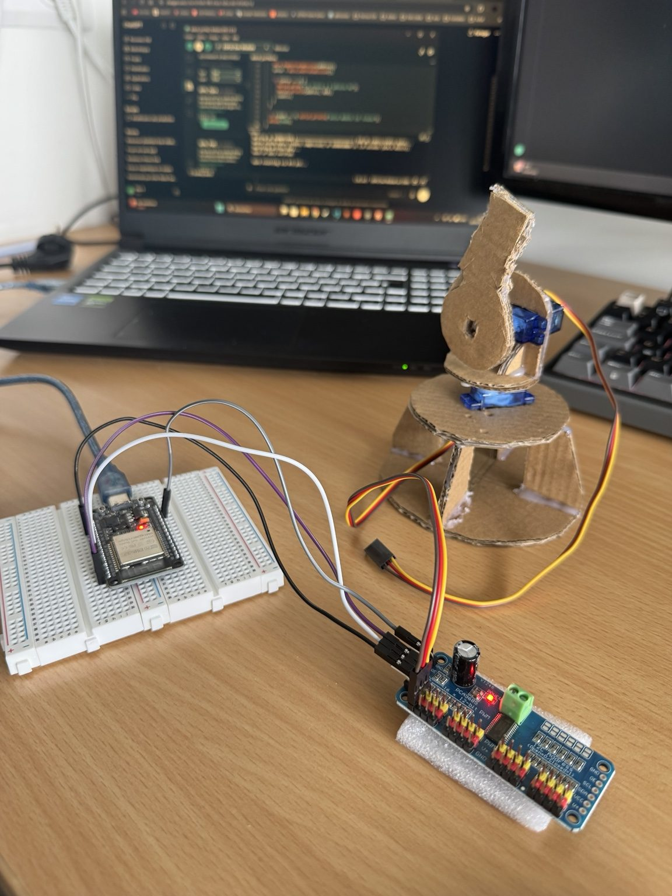
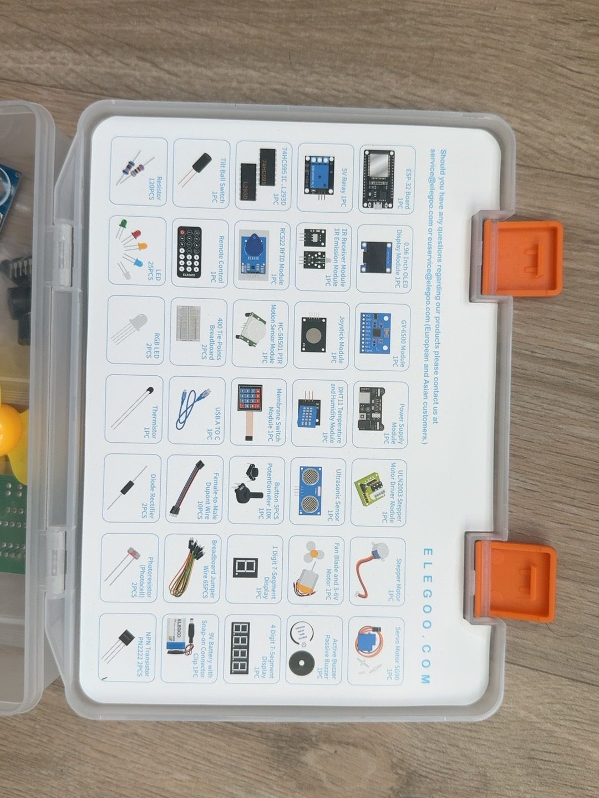
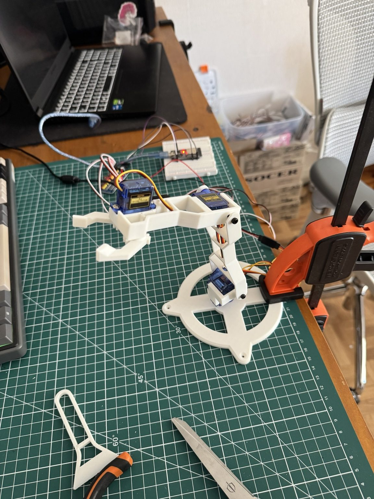
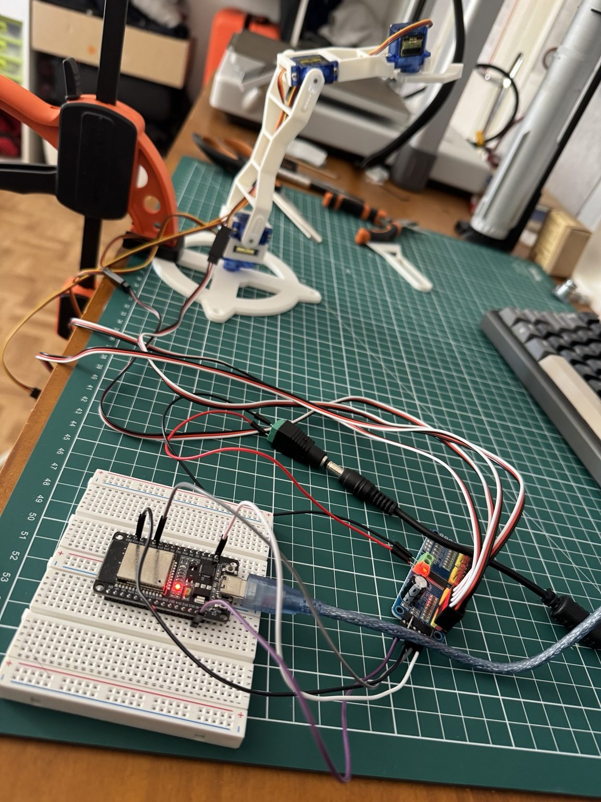
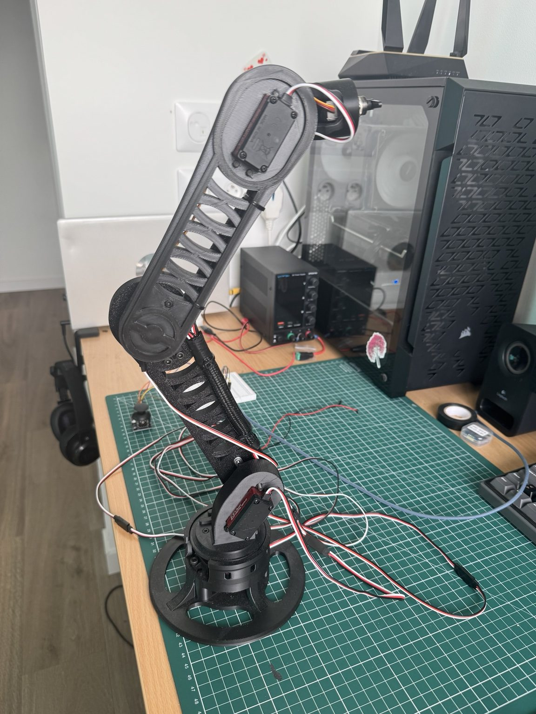
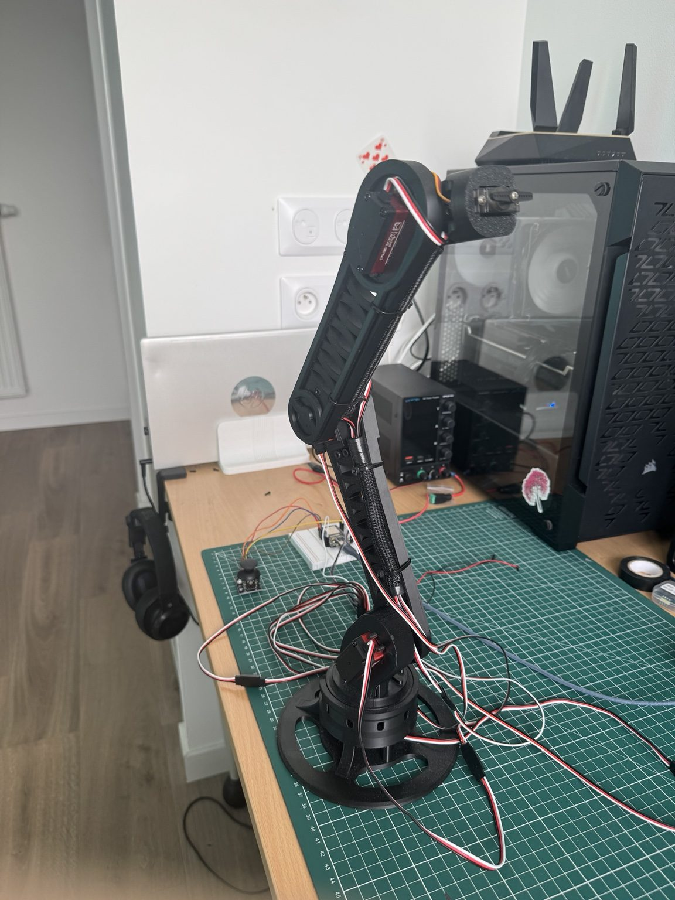
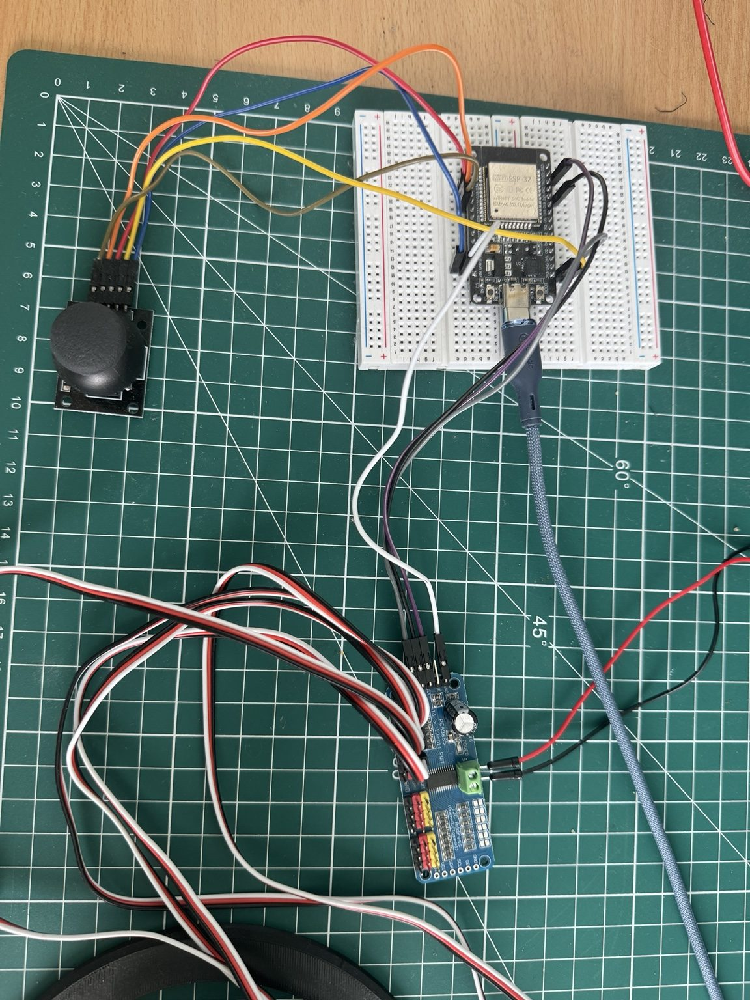

# Robotic Arm — From prototypes to a custom design

**Personal robotics project | Fusion 360 · ESP32 · C++ / Arduino · Electronics · 3D printing**

**Status:** V3 in progress — gripper unfinished; wrist rotation control still under investigation.

I'm building a robotic arm to learn by making: understanding mechanical loads, choosing actuators, designing parts, printing them, wiring electronics and testing embedded control. My interest in robotics also connects to my passion for aerospace and space exploration.

## Project evolution

| Version | Approach | What I learned | Status |
|---|---|---|---|
| **V1** | Handmade, multilayer cardboard arm; SG90 servos; 2 motions | Weight, torque, motor mounting and basic electronics | Prototype completed |
| **V2** | Printed an existing online 3D design; assembled and programmed approximately 4 motorized joints | Multi-servo control, motor current, limits of lightweight actuators | Prototype tested |
| **V3** | My own Fusion 360 design, PETG printing, stronger servos and external power | Mechanical support, joint design, PWM control, power distribution | **Work in progress** |
| **V4** | Bearings, improved transmissions, custom electronics and sensing | Future design direction | Concept only |

### V1 — Cardboard proof of concept

I laminated thin cardboard to create a rigid structure. The unintended weight of the cardboard and glue was too much for the SG90 servos. Mounting the motors without permanently gluing them was another challenge. I kept the prototype to two motions, rotation and inclination, and used it to study the ESP32 and basic electronics.

### V2 — Learning from an existing design

I **did not design the geometry of V2**. I found a 3D model online and printed, assembled, wired and programmed it myself. Coordinating four motors exposed a major electrical mistake: powering multiple servos from the ESP32 was unsuitable. This pushed the project toward dedicated motor power and a common ground.

### V3 — My own mechanical design

I designed the arm in **Fusion 360**, printed the parts in **PETG** using a **Bambu Lab A1**, and moved to a separate **6 V laboratory supply** for servo power, an **ESP32**, a **PCA9685** (16-channel PWM controller), and an analog joystick.

The target design has **five motorized arm/wrist axes plus a future gripper function**. Four main joints use stronger Miuzei-class servos, with a smaller Miuzei MF90 at the wrist. The exact main-servo model and manufacturer ratings still need verification.

**Current technical challenges:** Several joints rely too heavily on one servo shaft as a mechanical bearing, creating flex and backlash. The rotating base also experiences stick-slip due to plastic-on-plastic friction. The wrist-rotation servo has exhibited unwanted motion at rest. These are open issues, not solved features.

### Hardware and control

| Component | Role |
|---|---|
| ESP32 | Main controller (Arduino / C++) |
| PCA9685 | Servo PWM, I²C address `0x40`, typically 50 Hz |
| Bench power supply | External servo supply; tests at 6 V, current limit 3 A |
| Joystick | Relative-speed control, switching between three modes |
| Fusion 360 + PETG | Custom mechanical design and printed parts |

**Joystick modes:** base + shoulder → elbow + wrist tilt → wrist rotation + future gripper. Firmware also explores persistence of commanded positions using ESP32 `Preferences`. Some features remain experimental and require further validation.

## Key lessons

- Servo torque is only part of the problem: lever arms, mass distribution, bearings and rigidity matter too.
- Drive signals and motor power must be handled separately.
- Printed-part strength depends on geometry, layer orientation, walls, infill and print supports.
- A mechanical problem is not always fixable by software.
- AI tools supported my programming and research, but I distinguish assisted work from independently verified results.

## Roadmap

- [ ] Finish and test the gripper
- [ ] Stabilize wrist rotation and validate the complete firmware
- [ ] Measure dimensions, mass, travel, electrical consumption and achievable load
- [ ] Improve cable routing and mechanical support
- [ ] Explore an ESP32-CAM, sensors and object recognition
- [ ] Explore integration with my **OSIRIS** personal application
- [ ] Study a V4 with bearings, passive shafts, transmissions, metal components and custom electronics

## Project files

- [V3 Arduino / C++ firmware](firmware/sketch_sep6a.ino)
- [Fusion 360 design archive](cad/ARM-v2.1.f3z)
- [V3 technical architecture](docs/architecture-v3.md)

## Repository material

The photographs, experimental Arduino firmware and Fusion 360 archive are now available in this repository. Measured performance data and additional technical notes will be added as the project progresses. **The V2 design comes from a third party and will not be redistributed without checking its source and license.**

**Author:** Alexandre Goulhot-Lassalle  
*Project documentation — October 2026.*
